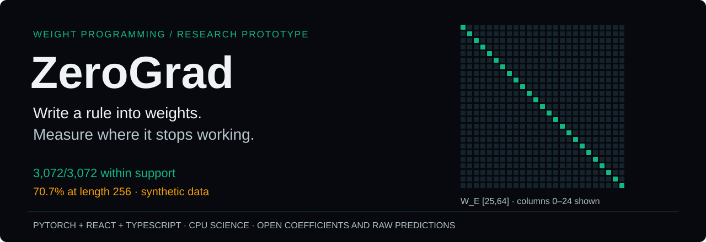
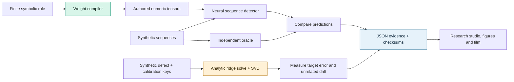
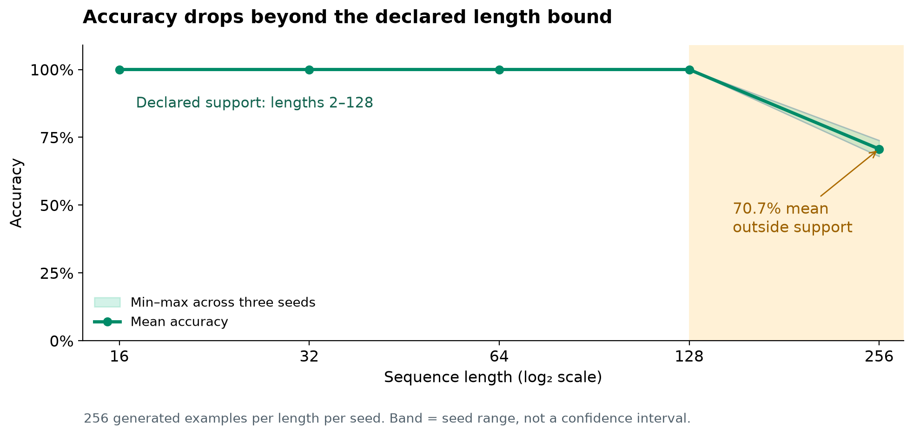
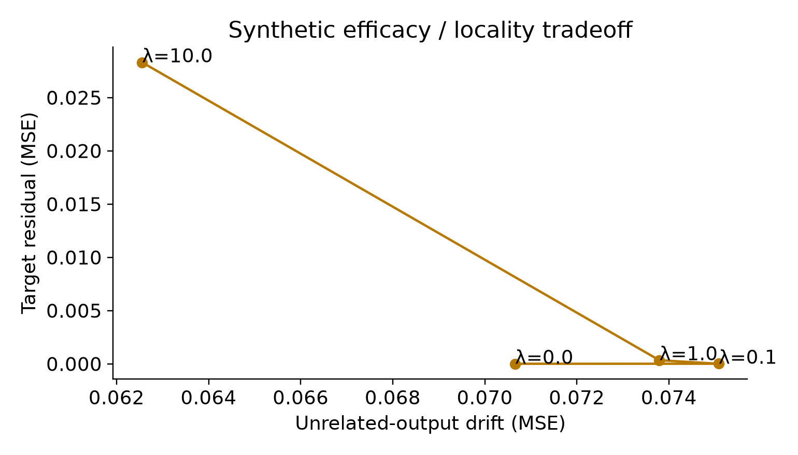
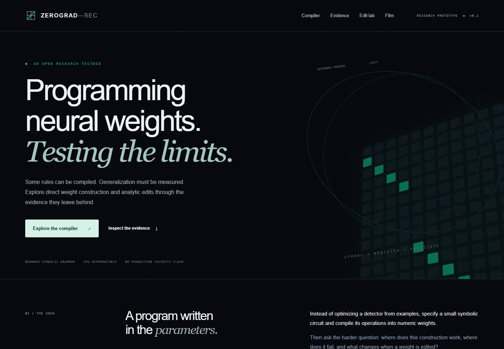

<p align="center">
  
</p>

# ZeroGrad-Sec

**A reproducible laboratory for writing rules into neural weights and measuring targeted weight edits.**

Most neural networks learn their weights from examples. This project starts with a small, explicit rule, derives weights that compute it, and tests the resulting network against an independent reference program. A second experiment calculates a low-rank correction to a synthetic model defect and measures the changes it causes elsewhere.

Python · PyTorch · React · TypeScript · FFmpeg · [MIT license](LICENSE)

[Research report](paper/zerograd_sec_paper.md) · [Studio setup](studio/README.md) · [Watch the film](outputs/zerograd_widescreen.mp4) · [Raw results](telemetry/benchmark_results.json) · [Claim register](docs/CLAIM_REGISTER.md)

> **Scope:** This is an unreviewed research prototype using safe, synthetic symbols. Its results concern a bounded grammar and a synthetic linear association memory. Real-world threat detection, semantic understanding and pretrained language-model repair remain untested.

## The idea, in plain language

**Weights** are the numbers that control a neural network's computation. Training usually adjusts them through repeated examples and gradient updates. For some small, precisely specified tasks, we can derive useful settings directly.

ZeroGrad-Sec investigates that approach through two tracks:

| Track | Input | What the code does | Evidence |
|---|---|---|---|
| **A · Compile** | An explicit finite sequence rule | Builds numeric embedding, routing, gate and readout tensors without optimizer steps | Independent-oracle comparisons, tensor recipes, negative tests |
| **B · Edit** | A known synthetic association error | Solves for a covariance-regularized update, then factors it with SVD | Target error, unrelated-output drift, rank and control edits |

The name **ZeroGrad** applies to direct compilation and analytic editing. The AdamW comparison **does use gradients**.

## A small rule you can inspect

The toy detector checks whether a START marker appears before a FINISH marker for the same entity:

```text
START(entity 2) → harmless padding → FINISH(entity 2)   ✓ ordered match
FINISH(entity 2) → START(entity 2)                     ✗ reversed order
START(entity 2) → FINISH(entity 3)                     ✗ different entities
```

The vocabulary represents three abstract signatures, two stages and four entity IDs. The classifier returns one of four labels, including BENIGN; the highest matching signature takes precedence when patterns overlap. These symbols model structural conditions rather than executable security operations.

The neural forward pass computes the answer from its tensors. A separate Python oracle supplies reference labels for testing; the forward pass never calls it.

## How the system fits together



The main experiment uses a compact prefix circuit. A **separate four-block transformer** expresses the same narrow grammar with four heads, a 64-dimensional residual stream, 16 features per head and a 256-feature ReLU MLP. Three blocks perform computation; the fourth is identity, and three heads per block route zero values. Its attention is uniform causal softmax, with no LayerNorm or learned semantic representation.

See the [prefix derivation](specs/ZEROGRAD_MATH_SPEC.md), [transformer extension](specs/TRANSFORMER_EXTENSION.md), and [symbolic assignment IR](specs/SYMBOLIC_CIRCUIT_IR.md).

## Measured results, including the failure

| Experiment | Observation | Interpretation |
|---|---|---|
| Prefix circuit, lengths 16–128 | **3,072/3,072** oracle agreement across three seeds | Agreement on the generated supported test cases |
| Prefix circuit, length 256 | **70.7%** mean accuracy | The same construction degrades beyond its declared support |
| Prefix circuit, length 512 | A constructed late-pair example fails | An explicit counterexample to an arbitrary-length claim |
| Four-block extension | **1,792/1,792** agreement, including dense mixtures, within tested support | A separate narrow transformer construction, not a semantic security model |
| Synthetic analytic edit, λ = 1 | Target MSE **3.640517 → 0.000334** | A known synthetic defect improves |
| The same edit | Unrelated-output drift MSE **0.073793** | The repair also changes unrelated outputs |



The generator uses 256 examples per length per seed. The chart's band shows the **range across seeds**, not a confidence interval. Per-cell Wilson intervals, class supports and result IDs are in the [JSON results](telemetry/benchmark_results.json); the [CSV](outputs/metrics.csv) supports independent plotting. Transformer results live in a [separate artifact](telemetry/transformer_validation.json).

### The editor also has a tradeoff

The editor chooses a weight change that balances target repair against movement on calibration examples. It solves a linear system, then uses singular value decomposition to represent the correction with smaller factors.



Regularization does **not** guarantee lower drift on held-out inputs: in this run, λ = 1 has drift 0.073793, while the unregularized control has 0.070657. The covariance comes from a favorable synthetic distribution. This experiment cannot establish locality on real model activations.

Low rank also differs from entry sparsity: the rank-two λ = 1 adapter has **48 factor parameters**, but its materialized correction changes **all 128 entries** of this 8 × 16 matrix. [Editor results and controls →](outputs/track_b_edit_report.md)

<details>
<summary>Open the analytic objective and dimensions</summary>

For a weight matrix $W$, edit keys $K$, desired values $V$, and residual $R=V-WK$, the editor minimizes

$$\|\Delta W K-R\|_F^2+\frac{\lambda}{n_0}\|\Delta W X_0\|_F^2+\varepsilon\|\Delta W\|_F^2.$$

With $C_0=X_0X_0^T/n_0$, the normal equations give

$$\Delta W=RK^T(\lambda C_0+KK^T+\varepsilon I)^{-1}.$$

The implementation uses a **stable linear solve**, not a literal matrix inverse. Here $W\in\mathbb{R}^{d_{out}\times d_{in}}$, $K\in\mathbb{R}^{d_{in}\times m}$ and $V\in\mathbb{R}^{d_{out}\times m}$. The [math specification](specs/ZEROGRAD_MATH_SPEC.md) derives the objective and states its limits. This is an associative-memory adaptation, not the full multilayer MEMIT procedure.

</details>

## Explore the research studio



Scrub recorded tensor writes, inspect coordinate values, compare measured benchmark rows, select recorded edits, and open the supporting documents. Register and covariance illustrations carry schematic labels; they are not measured activation maps or PCA projections.

The studio is a static React/TypeScript app. It has no paid API dependency, account requirement or model download. Build it locally using the instructions below; no hosted demo is claimed.

## Run it on your machine

Python 3.11+ and Node 24 are the project targets. The authoring host used Python 3.13 on Windows with existing scientific packages. The checked-in version snapshot records that environment; a fresh online installation has not been verified on this host because its shell network access is restricted.

```bash
git clone https://github.com/KaidAkram/ZeroGrad.git
cd ZeroGrad
python -m venv .venv
```

**Windows PowerShell** (no environment activation script required):

```powershell
.venv/Scripts/python -m pip install -r requirements-cpu.txt
.venv/Scripts/python -m pytest -q
.venv/Scripts/python run_all.py --mode smoke --offline --skip-real-llm
```

<details>
<summary>Linux / macOS commands</summary>

```bash
.venv/bin/python -m pip install -e . pytest psutil
.venv/bin/python -m pytest -q
.venv/bin/python run_all.py --mode smoke --offline --skip-real-llm
```

The scientific code uses CPU-safe PyTorch operations. Linux/macOS setup is provided for reproduction but has not been executed on the authoring host. Studio native dependency recovery and the browser QA executable path were audited on Windows; see [studio environment notes](studio/README.md).

</details>

**Run the bounded benchmark suite** with the Python executable from your environment:

```bash
python run_all.py --mode benchmark --offline --skip-real-llm
python run_all.py --mode paper
```

Smoke mode writes a small independent result and a real-data figure. Benchmark mode writes the main results, per-example predictions and transformer extension. Add `--resume` to reuse a science checkpoint only when its source/seed fingerprint matches. Install dependencies before using `--offline`; the core experiments themselves require no network.

**Build and open the studio:**

```bash
cd studio
npm ci
npm run build
npm run dev
```

Use `npm.cmd` in PowerShell if your execution policy blocks `npm.ps1`. The production output is `studio/dist/`, which the build generates; it is not committed. After building, you can also serve it from the repository root:

```bash
python -m http.server 4173 --directory studio/dist
```

Open `http://localhost:4173`. Opening `index.html` directly cannot fetch its JSON evidence.

### Regenerate the figures and film

```bash
python run_all.py --mode paper
python run_all.py --mode media --quality preview
python run_all.py --mode media --quality final
python scripts/verify_media.py
python run_all.py --mode release-check
```

Rendering requires FFmpeg and ffprobe on PATH. The delivered motion uses an original deterministic Pillow/FFmpeg renderer; Remotion installation was blocked by the host. Videos are silent and include separate subtitle files.

| Delivered asset | Format |
|---|---|
| [Portrait film](outputs/zerograd_linkedin_reel.mp4) | 45 s · 1080 × 1350 · 60 fps |
| [Widescreen film](outputs/zerograd_widescreen.mp4) | 45 s · 1920 × 1080 · 60 fps |
| [Teaser](outputs/zerograd_teaser_12s.mp4) | 12 s · 1080 × 1350 · 60 fps |
| [Preview](outputs/zerograd_preview.mp4) | 5 s · 720 × 900 · 60 fps |
| [Carousel contact sheet](outputs/carousel_montage.png) | Six original 1080 × 1350 panels; [copy, alt text and editable sources](career/LINKEDIN_CAROUSEL_COPY.md) |
| [Captions](outputs/zerograd_subtitles.srt) | SRT; [WebVTT](outputs/zerograd_subtitles.vtt) for the studio player |

The film links open the actual files; GitHub may offer a download rather than inline playback. The local studio provides a player. [Encoded-video verification →](outputs/MEDIA_QA.json)

## Evidence and reproducibility

The repository includes tests for supported oracle agreement, wrong-order/entity behavior, causal masks, frozen compilation tensors, gate arithmetic, out-of-support failure, ridge normal equations, SVD reconstruction, patch rollback and schema/checksum rejection. Browser checks exercise replay controls, filters, the film, document links, mobile overflow and reduced motion.

Verification records live in [Python test XML](outputs/test_results.xml), [browser QA](studio/qa/results.json), and [release status](outputs/RELEASE_STATUS.md). The [delivery manifest](outputs/DELIVERY_MANIFEST.json) records artifact sizes and SHA256 hashes. The GitHub Actions workflow exists in [.github/workflows/ci.yml](.github/workflows/ci.yml); local checks do not imply hosted CI success.

| Inspect | Entry point |
|---|---|
| Independent reference rule, generator and compact compiler | [src/zerograd/core.py](src/zerograd/core.py) |
| Four-block transformer and authored tensor recipes | [src/zerograd/model_wsp.py](src/zerograd/model_wsp.py) |
| Main benchmark, diagnostic baselines and edit controls | [evaluation/run_benchmarks.py](evaluation/run_benchmarks.py) |
| Transformer evaluation | [evaluation/transformer_validation.py](evaluation/transformer_validation.py) |
| Typed telemetry and deterministic replay | [telemetry module](src/zerograd/telemetry.py), [recorded writes](telemetry/weight_write_stream.json) |
| Patch apply/undo with integrity checks | [src/zerograd/patch_io.py](src/zerograd/patch_io.py) |
| Shared artifact runner | [run_all.py](run_all.py) |

## Research limits and next experiments

- **Bounded representation.** Two symbolic stages, four entity IDs, explicit length assumptions. This does not establish arbitrary-length state tracking or semantic understanding.
- **Diagnostic comparisons.** The feature MLP and retrieval methods use different representations. They do not form an architecture-matched performance leaderboard. Optimized matched training, WSP-Hybrid and gradient-trained LoRA remain unrun.
- **Synthetic editing.** The edited checkpoint is a linear association memory. Real pretrained-model repair, paraphrase generalization and production safety preservation remain untested.
- **Small protocol.** The full sample-size grid, disjoint compositional templates, realistic class skew, broad calibration metrics and systematic latency/memory profiling remain open.

The next research gate is an **identical-architecture, validation-tuned training comparison on disjoint compositional templates**, followed by calibration-shift editing controls and independent replication. [Protocol](docs/EXPERIMENT_PROTOCOL.md) · [Known limitations](docs/KNOWN_LIMITATIONS.md) · [Roadmap](docs/RESEARCH_ROADMAP.md)

## Related work and attribution

The project draws on [RASP](https://arxiv.org/abs/2106.06981) and [Tracr](https://arxiv.org/abs/2301.05062) for programmable sequence computation, [ROME](https://arxiv.org/abs/2202.05262) and [MEMIT](https://arxiv.org/abs/2210.07229) for model editing, and [LoRA](https://arxiv.org/abs/2106.09685) for the distinction between low-rank representation and gradient-trained adaptation. The [literature notes](docs/LITERATURE_NOTES.md) record verified metadata, newer weight-space-programming reports and the differences from this implementation.

This repository contributes an auditable engineering testbed and a limited diagnostic study. It makes no priority, peer-review or general algorithmic superiority claim. References: [references.bib](references.bib). Software citation metadata: [CITATION.cff](CITATION.cff).

## Responsible use and contributing

Use this project to study explicit neural computations and reproducible evaluation. The input symbols are non-executable; the project includes no live exploits or offensive automation. Read the [ethics and threat model](docs/ETHICS_AND_THREAT_MODEL.md) before adapting it to security data.

Code and original graphics use the [MIT license](LICENSE). Third-party software keeps its own license; the [asset inventory](assets/LICENSES.md) records visual provenance. Reproduction reports and counterexamples are welcome: see [CONTRIBUTING.md](CONTRIBUTING.md) and [SECURITY.md](SECURITY.md).

Created by [Akram Kaid](https://github.com/KaidAkram). Repository: [https://github.com/KaidAkram/ZeroGrad](https://github.com/KaidAkram/ZeroGrad).
