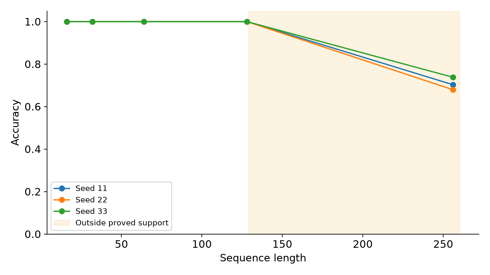

# ZeroGrad-Sec: bounded weight compilation and analytic edits

Technical report / unreviewed research prototype. Author: Akram Kaid. Affiliation not specified.

## Abstract
The compiled circuit matched the oracle on 3072/3072 generated examples at lengths 16–128 across three seeds. At length 256, mean accuracy fell to 70.7%; a constructed length-512 example fails. The rank-2 analytic patch reduced target MSE from 3.640517 to 0.000334, with unrelated-output drift MSE 0.073793. We expose coefficients, symbolic assumptions, raw predictions and replay checksums. This is an engineering testbed and a limited diagnostic study; no algorithmic novelty claim is made.

## Introduction and research questions
Can explicit sequence rules be expressed as numeric neural operations without optimization? Where does finite support break? Can a ridge-regularized update improve a controlled defect while measuring drift? This study answers these questions only for a finite grammar and a linear synthetic association memory.

## Related work
RASP and Tracr establish programming and compilation approaches for transformers. ROME and MEMIT motivate associative-memory edits; our normalized covariance/ridge objective is derived independently in [the math spec](../specs/ZEROGRAD_MATH_SPEC.md). LoRA trains low-rank updates; this analytic adapter uses a direct solve. Retrieval here has no generator and is not RAG. Verified source metadata and distinctions are in [literature notes](../docs/LITERATURE_NOTES.md).

## Formal task and methods
Tokens encode one of three abstract signatures, one of two stages and one of four entity IDs. A first-stage event must strictly precede the matching second-stage event. Highest matching class takes precedence. The compiler creates E[25,64], S/T[64,12] and U[3,3]; uniform strict causal attention and saturated ReLU gates recover bounded existence. See equations (1)–(4) in the math spec. This is an explicitly changed architecture, not standard four-block compilation.

## Protocol
Frozen protocol: [EXPERIMENT_PROTOCOL.md](../docs/EXPERIMENT_PROTOCOL.md). Seeds 11,22,33; disjoint train/test RNG seeds and exact sequence overlap exclusion. Each E2 cell uses 256 examples. E1 uses 50,200,1000 training examples and a fixed 100-step AdamW feature MLP, with no tuning. Wilson 95% intervals accompany every accuracy in JSON. They do not quantify grammar or model-selection uncertainty. Hard negatives are reversed, wrong-entity or incomplete pairs. The generated distribution is simple and has exploitable shortcuts.

## Results
The compiled circuit matched the oracle on 3072/3072 generated examples at lengths 16–128 across three seeds. At length 256, mean accuracy fell to 70.7%; a constructed length-512 example fails.

| Method | Length | Seed | Train N | Accuracy | Macro F1 |
|---|---:|---:|---:|---:|---:|
| WSP-Compiled | 16 | 11 | 0 | 1.0000 | 1.0000 |
| WSP-Compiled | 32 | 11 | 0 | 1.0000 | 1.0000 |
| WSP-Compiled | 64 | 11 | 0 | 1.0000 | 1.0000 |
| WSP-Compiled | 128 | 11 | 0 | 1.0000 | 1.0000 |
| WSP-Compiled | 256 | 11 | 0 | 0.7031 | 0.7089 |
| retrieval-histogram | 32 | 11 | 50 | 0.8047 | 0.7536 |
| retrieval-position | 32 | 11 | 50 | 0.3320 | 0.3033 |
| AdamW-feature-MLP | 32 | 11 | 50 | 0.7070 | 0.7138 |
| retrieval-histogram | 32 | 11 | 200 | 0.8203 | 0.7800 |
| retrieval-position | 32 | 11 | 200 | 0.6367 | 0.6583 |
| AdamW-feature-MLP | 32 | 11 | 200 | 0.8242 | 0.8117 |
| retrieval-histogram | 32 | 11 | 1000 | 0.9141 | 0.9077 |
| retrieval-position | 32 | 11 | 1000 | 0.8711 | 0.8643 |
| AdamW-feature-MLP | 32 | 11 | 1000 | 0.8633 | 0.8498 |
| WSP-Compiled | 16 | 22 | 0 | 1.0000 | 1.0000 |
| WSP-Compiled | 32 | 22 | 0 | 1.0000 | 1.0000 |
| WSP-Compiled | 64 | 22 | 0 | 1.0000 | 1.0000 |
| WSP-Compiled | 128 | 22 | 0 | 1.0000 | 1.0000 |
| WSP-Compiled | 256 | 22 | 0 | 0.6797 | 0.6942 |
| retrieval-histogram | 32 | 22 | 50 | 0.6953 | 0.6867 |
| retrieval-position | 32 | 22 | 50 | 0.3906 | 0.3787 |
| AdamW-feature-MLP | 32 | 22 | 50 | 0.6016 | 0.6281 |
| retrieval-histogram | 32 | 22 | 200 | 0.8867 | 0.8743 |
| retrieval-position | 32 | 22 | 200 | 0.5000 | 0.5319 |
| AdamW-feature-MLP | 32 | 22 | 200 | 0.7461 | 0.7482 |
| retrieval-histogram | 32 | 22 | 1000 | 0.9141 | 0.9077 |
| retrieval-position | 32 | 22 | 1000 | 0.9023 | 0.8993 |
| AdamW-feature-MLP | 32 | 22 | 1000 | 0.8555 | 0.8477 |
| WSP-Compiled | 16 | 33 | 0 | 1.0000 | 1.0000 |
| WSP-Compiled | 32 | 33 | 0 | 1.0000 | 1.0000 |
| WSP-Compiled | 64 | 33 | 0 | 1.0000 | 1.0000 |
| WSP-Compiled | 128 | 33 | 0 | 1.0000 | 1.0000 |
| WSP-Compiled | 256 | 33 | 0 | 0.7383 | 0.7537 |
| retrieval-histogram | 32 | 33 | 50 | 0.6914 | 0.6657 |
| retrieval-position | 32 | 33 | 50 | 0.3242 | 0.3325 |
| AdamW-feature-MLP | 32 | 33 | 50 | 0.4961 | 0.4965 |
| retrieval-histogram | 32 | 33 | 200 | 0.8047 | 0.7937 |
| retrieval-position | 32 | 33 | 200 | 0.5156 | 0.5389 |
| AdamW-feature-MLP | 32 | 33 | 200 | 0.7422 | 0.7237 |
| retrieval-histogram | 32 | 33 | 1000 | 0.8438 | 0.8387 |
| retrieval-position | 32 | 33 | 1000 | 0.8828 | 0.8748 |
| AdamW-feature-MLP | 32 | 33 | 1000 | 0.8281 | 0.8151 |
| WSP-Compiled | 32 | 11 | 0 | 1.0000 | 0.2500 |
| WSP-Compiled | 512 | 11 | 0 | 0.0000 | 0.0000 |

## Four-block transformer extension
The separately evaluated four-block transformer matched the oracle on 1792/1792 examples, including dense mixtures. It uses 4 heads, D=64, head width 16 and MLP width 256. Three blocks perform computation; block four and three heads per block are identity/zero paths. All 200196 tensor entries (including zeros) are directly authored; 161 are nonzero. Extension results and out-of-support failures are in telemetry/transformer_validation.json, with full write replay in transformer_weight_stream.json. This does not implement arbitrary multi-stage security tracking.

See [extension derivation](../specs/TRANSFORMER_EXTENSION.md). The main benchmark table and media remain the original prefix-circuit experiment.

## Analytic editing and controls
The rank-2 analytic patch reduced target MSE from 3.640517 to 0.000334, with unrelated-output drift MSE 0.073793. All 128 entries of the 8x16 matrix change; the rank-two factors contain 48 parameters. Low rank is not entry sparsity. Calibration and unrelated draws are independent Gaussian samples with deliberately low variance in the first two coordinates. This favorable construction is not real activation evidence. Naive lambda=0, shuffled targets and norm-matched random directions are reported in the JSON. No paraphrase, token KL, or perplexity metric is defined for this linear module.

## Ablations and negative results
Length 256 lies outside the proved support and produces failures. A single late ordered pair at length 512 is rejected. Exact support is a property of the saturation scaling, not of high-temperature softmax. Q=K=0 means beta does not affect this uniform attention variant; the requested content-selector beta sweep remains NOT RUN. Wrong-order/entity near misses are evaluated separately. Full mixture/compositional and skewed-prior studies remain open.

## Threats to validity
These are synthetic, finite symbolic tasks. The main benchmark and studio replay use the prefix circuit. A separately validated four-block transformer implements the same narrow two-stage grammar; three blocks compute and one is identity. The feature MLP and retrieval baselines are diagnostic and not architecture-matched. No semantic or real pretrained-model claim is supported. The synthetic association checkpoint is a linear module, not a full synthetic transformer. The baselines have unequal representations and inductive biases. These data cannot establish superiority over learned semantic models. Accuracy on the simple generator is not security efficacy. No cross-template generalization study, ECE/AUROC suite, latency quantiles or memory profiling was completed.

## Responsible use
Only non-executable abstract tokens are shipped. No syscall capture, exploit payload, real prompt bypass or live target is involved. Do not use this as an intrusion detection system.

## Reproducibility
Run `python run_all.py --mode benchmark --offline --skip-real-llm`, then `python run_all.py --mode paper`. Measured benchmark elapsed time: 14.129 seconds in this environment. CPU-only scientific path; version snapshot in requirements-observed.txt. Raw examples and predictions: telemetry/raw/predictions.json. Checksums: telemetry/manifest.json. Exact write replay is tested. Timing varies by host.

## Conclusion
The useful result is an auditable bounded construction and a visible failure boundary. Next, compare the identical circuit architecture under learning, extend compositional generators, and test calibration shift before attempting a real checkpoint repair.

## References
See references.bib and docs/LITERATURE_NOTES.md. Author/affiliation and archival release identifiers must be supplied before external submission.
